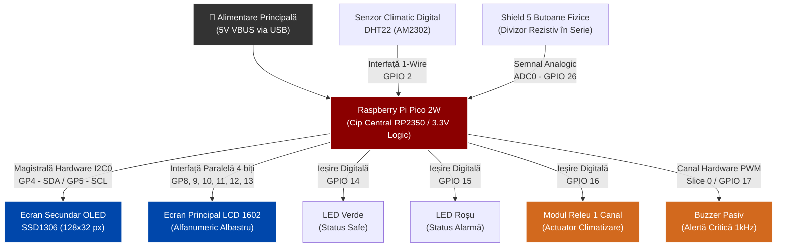
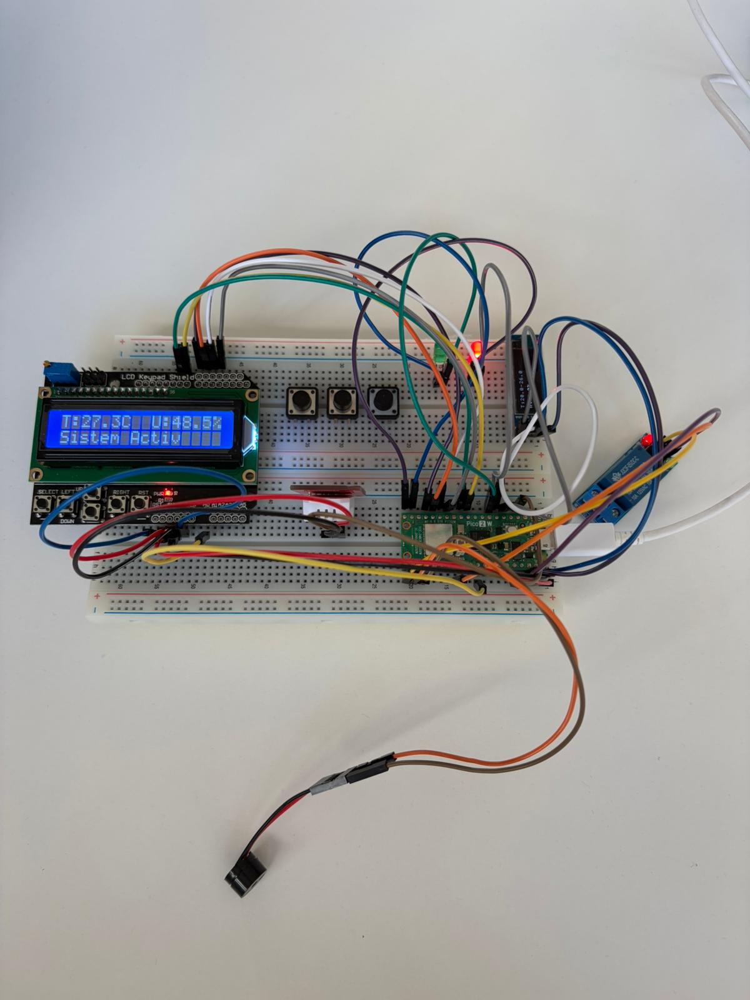
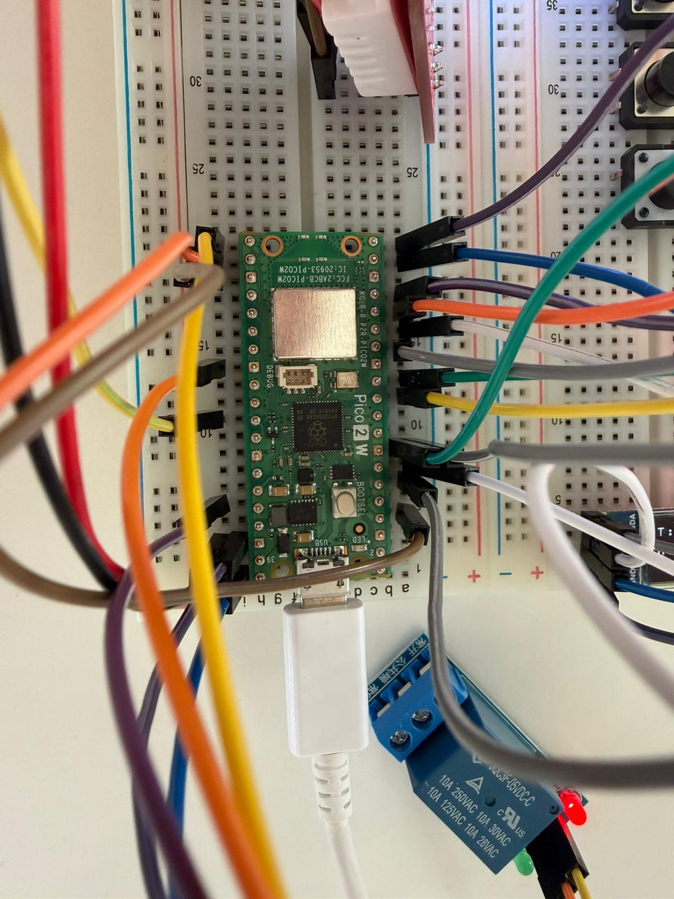
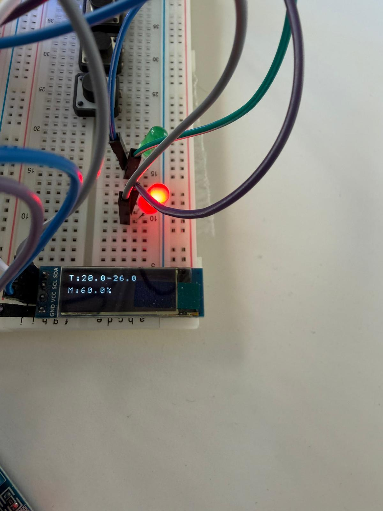

# Sistem Digital de Monitorizare și Alertă Climatică cu Interfață Dual-Display (Raspberry Pi Pico 2W)

**Disciplina:** Sisteme cu Microprocesoare  
**Echipă:** Postolache Matei, Maxim Cezar-Andrei — Grupa 1307B

Acest repository conține documentația tehnică completă și codul sursă pentru sistemul de monitorizare climatică, ce achiziționează parametri de mediu (temperatură și umiditate), îi afișează pe un sistem dual-display și declanșează alerte sonore/vizuale/mecanice la ieșirea din praguri configurabile, implementat pe microcontrolerul Raspberry Pi Pico 2W (RP2350).

---

## Etapa 2: Cerințe Funcționale, Non-Funcționale și Scenarii de Testare

### 1. Cerințe Funcționale

| ID | Descriere Cerință | Componentă Hardware Asociată |
|:---:|:---|:---|
| **1** | Achiziția automată a temperaturii și umidității din mediul ambiant. | Senzor Digital DHT22 (Protocol 1-Wire, GPIO 2) |
| **2** | Afișarea în timp real a valorilor climatice curente pe ecranul principal. | Ecran LCD 1602 (Mod paralel 4 biți, GPIO 8–13) |
| **3** | Afișarea pragurilor de control configurabile pe ecranul secundar. | Ecran OLED SSD1306 (I2C0 – GPIO 4/5) |
| **4** | Modificarea interactivă a pragurilor în trepte prin butoane fizice. | Shield 5 Butoane (Rețea rezistivă, ADC0 – GPIO 26) |
| **5** | Resetarea instantanee a limitelor la valorile de siguranță (butonul SELECT). | Shield 5 Butoane (ADC0 – GPIO 26) |
| **6** | Controlul unui actuator extern (releu) și al indicatorilor vizuali (LED-uri) în funcție de starea climatică. | Modul Releu (GPIO 16), LED Verde (GPIO 14), LED Roșu (GPIO 15) |
| **7** | Declanșarea unei avertizări acustice de urgență prin semnal PWM la anomalie termică critică (deviere ≥ 5°C). | Buzzer Pasiv (PWM Slice 0, Channel B – GPIO 17) |

### 2. Cerințe Non-Funcționale

- **Economie de Resurse:** Maparea a 5 butoane independente pe un singur pin analogic ADC0 (GP26) utilizând o rețea rezistivă, reducând numărul de pini GPIO consumați.
- **Fiabilitate și Precizie:** Interogarea senzorului DHT22 la intervale de minimum 2 secunde pentru a preveni auto-încălzirea elementului intern și a asigura citiri corecte.
- **Toleranță la Erori (Fault Tolerance):** Rutinele de comunicație cu senzorul returnează coduri de eroare verificate explicit, prevenind blocarea sistemului în cazul deconectării fizice sau al unui timeout pe magistrala 1-Wire.
- **Gestionarea temporizărilor:** Aplicația utilizează temporizări prin `sleep_ms()` pentru scanarea butoanelor și pentru anumite operații hardware. Controlul buzzerului este realizat prin perifericul PWM, fără generarea software continuă a semnalului.
- **Degrevarea Procesorului:** Alarma termică utilizează perifericul hardware PWM la ~1 kHz cu factor de umplere 50%, sunetul fiind generat independent de CPU fără a consuma resurse de procesare suplimentare.

### 3. Scenarii de Testare

#### Scenariul A: Confort – Sistem în Parametri Nominali

**Obiectiv:** Validarea stării de repaus a sistemului atunci când temperatura se află în intervalul configurat.

**Etape de execuție:**
1. Sistemul este pornit, pragurile implicite sunt încărcate (ex: 20°C–26°C). Ecranul LCD afișează valorile curente, OLED afișează pragurile active.
2. Temperatura măsurată de DHT22 se află în intervalul permis.
3. Microcontrolerul evaluează comparația și menține ieșirile de alarmă inactive.

**Rezultat așteptat:** LED-ul Verde rămâne aprins, releul este decuplat, buzzerul este oprit.

---

#### Scenariul B: Alarmă Standard – Depășire Prag Maxim

**Obiectiv:** Validarea activării actuatorului extern fără declanșarea alertei critice sonore.

**Etape de execuție:**
1. Temperatura depășește limita maximă configurată (ex: >26°C), dar deviația față de prag este mai mică de 5°C.
2. Microcontrolerul detectează ieșirea din parametri.
3. LED-ul Roșu se aprinde, LED-ul Verde se stinge, releul se activează (cuplează instalația externă de climatizare).

**Rezultat așteptat:** Releul este activ, LED-ul Roșu este aprins, buzzerul rămâne inactiv (deviație < 5°C).

---

#### Scenariul C: Alarmă Critică – Deviere Termică Majoră

**Obiectiv:** Validarea declanșării alertei sonore la depășire critică a pragului.

**Etape de execuție:**
1. Pragul maxim este coborât la 19°C prin butoane. Temperatura curentă depășește pragul cu mai mult de 5°C.
2. Microcontrolerul detectează deviația critică și activează canalul PWM al buzzerului la ~1 kHz.

**Rezultat așteptat:** Releul rămâne activ, LED-ul Roșu este aprins, buzzerul emite un sunet continuu.

---

#### Scenariul D: Reset – Restaurare Praguri Implicite

**Obiectiv:** Validarea funcției de reset prin butonul SELECT.

**Etape de execuție:**
1. Sistemul se află în stare de alarmă. Utilizatorul apasă butonul SELECT.
2. Pragurile sunt restaurate instantaneu la valorile de siguranță (20°C / 26°C).

**Rezultat așteptat:** Alerta sonoră se oprește instantaneu, pragurile de pe OLED sunt actualizate, sistemul revine la evaluarea normală.

---

## Etapa 3: Diagramă de Componente / Schemă Bloc

Arhitectura hardware este structurată ierarhic, cu Raspberry Pi Pico 2W în centru, orchestrând achiziția de la senzori, afișarea duală și controlul actuatoarelor.

---

## Etapa 4: Parametrii Relevanți ai Componentelor și Argumentare

### 1. Centralizator Parametri Tehnici

| Componentă | Parametri Cheie |
|:---|:---|
| **Raspberry Pi Pico 2W (RP2350)** | Dual ARM Cortex-M33 @ 150 MHz; tensiune logică 3.3V; ADC 12-bit; PWM hardware nativ; Wi-Fi 2.4 GHz |
| **Senzor DHT22** | Alimentare 3.3–6V; protocol 1-Wire single-bus; precizie temperatură ±0.5°C; umiditate ±2–5% RH; interval minim interogare 2s |
| **Ecran LCD 1602** | Controler HD44780; interfață paralelă 4/8 biți; 2 rânduri × 16 caractere; tensiune logică 5V (compatibil prin nivel logic) |
| **Ecran OLED SSD1306** | Protocol I2C, adresă `0x3C`; rezoluție 128×32 px; consum redus; tensiune logică 3.3V |
| **Shield 5 Butoane** | Ieșire analogică unică; rețea rezistivă cu 5 tensiuni distincte; compatibil ADC 12-bit; mapare pe un singur pin GPIO |
| **Modul Releu** | Intrare logică 3.3/5V (Active High); izolat optic; comutare sarcini AC/DC externe |
| **Buzzer Pasiv** | Necesită semnal PWM extern pentru generarea tonului; frecvență de lucru recomandată 1–4 kHz |

### 2. Argumentarea Arhitecturii

**Alegerea DHT22 față de DHT11** oferă o precizie semnificativ mai bună (±0.5°C față de ±2°C) și acoperă un interval de umiditate mai larg, justificând utilizarea sa într-un sistem de monitorizare climatică.

**Multiplexarea butoanelor pe ADC** prin rețea rezistivă este o soluție elegantă de economie de pini. Cei 5 butoane generează 5 tensiuni distincte pe un singur pin analogic, lăsând mai mulți pini GPIO disponibili pentru periferice de afișare și control.

**Sistemul dual-display** separă informația: LCD 1602 prezintă valorile curente (ce este acum), iar OLED SSD1306 prezintă configurația activă (ce limitem). Această separare cognitivă reduce efortul de interpretare al utilizatorului.

---

## Etapa 5: Schemă Electrică și Procesul de Testare

### 1. Alocare Pini (Pinout Map)

| Componentă Hardware | Pin Componentă | Pin Raspberry Pi Pico 2W | Tip Configurație |
|:---|:---|:---|:---|
| **Senzor DHT22** | DATA | `GPIO 2` (Pin 4 fizic) | Digital Input (Internal Pull-Up) |
| **Ecran OLED SSD1306** | SDA | `GPIO 4` (Pin 6 fizic) | Interfață Hardware I2C0 |
| **Ecran OLED SSD1306** | SCL | `GPIO 5` (Pin 7 fizic) | Interfață Hardware I2C0 |
| **Ecran LCD 1602** | RS | `GPIO 8` (Pin 11 fizic) | Digital Output |
| **Ecran LCD 1602** | E (Enable) | `GPIO 9` (Pin 12 fizic) | Digital Output |
| **Ecran LCD 1602** | D4 – D7 | `GPIO 10` – `GPIO 13` | Ieșiri Digitale Paralele (4-bit) |
| **LED Verde** | Anod (+) | `GPIO 14` (Pin 19 fizic) | Digital Output |
| **LED Roșu** | Anod (+) | `GPIO 15` (Pin 20 fizic) | Digital Output |
| **Modul Releu** | IN / SIG | `GPIO 16` (Pin 21 fizic) | Digital Output (Active High) |
| **Buzzer Pasiv** | Pozitiv (+) | `GPIO 17` (Pin 22 fizic) | PWM Output (Slice 0, Channel B) |
| **Shield 5 Butoane** | OUT / DATA | `GPIO 26` / ADC0 | Intrare Analogică (12-bit) |

### 2. Procesul de Testare și Integrare HW-SW

1. **Interpretarea valorilor ADC: Cele 5 butoane sunt conectate la un singur canal ADC printr-o rețea rezistivă. Identificarea butonului apăsat se realizează prin compararea valorii returnate de `adc_read()` cu intervale numerice prestabilite. Utilizarea intervalelor, în locul unor valori exacte, permite tolerarea variațiilor semnalului analogic.

2. **Configurarea perifericului PWM: Pinul GPIO17 este configurat pentru funcționarea PWM utilizând `gpio_set_function()`. Controlul buzzerului se realizează prin modificarea factorului de umplere cu `pwm_set_chan_level()`, permițând pornirea și oprirea alarmei sonore fără generarea continuă a semnalului prin software.

3. **Optimizarea afișajului OLED 128×32:** Ecranul de 128×32 pixeli nu permitea afișarea a 3 rânduri de text fără suprapunerea pixelilor. Informația a fost compactată pe două rânduri aerisite, cu coordonatele Y=0 și Y=16, asigurând lizibilitate maximă.

4. **Gestionarea temporizărilor: Scanarea butoanelor se realizează prin interogarea periodică a canalului ADC, utilizând o întârziere de 10 ms între verificări în bucla de scanare. După detectarea unei apăsări este introdusă o întârziere suplimentară de 500 ms. Citirea senzorului DHT22 se realizează secvențial, utilizând temporizări pentru comunicarea cu senzorul.

---

## Etapa 6: Schemă Bloc Software

Logica aplicației este guvernată de o buclă principală `main()` non-blocantă, structurată pe trei niveluri de abstractizare.

### Arhitectura Codului Sursă

Implementarea este stratificată pe trei niveluri de abstractizare:

- **Low-Level:** Drivere directe pe registre prin Pico SDK pentru LCD 1602 (mod paralel pe 4 biți) și OLED SSD1306 (magistrală I2C hardware).
- **Mid-Level:** Funcții dedicate de achiziție — citire ADC 12-bit pentru butoane și protocol de precizie 1-Wire pentru senzorul DHT22.
- **High-Level:** Bucla principală `main()` care unifica logica de comparare, actualizarea afișajelor și controlul actuatoarelor.

Matricea custom de caractere `font_basic[17][8]` este stocată direct în Flash, reducând consumul de memorie RAM. Butoanele sunt referențiate prin ID-uri numerice `#define` (`BTN_UP`, `BTN_DOWN` etc.), eliminând comparările lente pe string-uri din C și riscul de erori de memorie.

---

## Etapa 7: Documentare Foto și Video

Această secțiune centralizează elementele vizuale utilizate pentru a demonstra și reproduce structura fizică a sistemului de monitorizare.

**Video Demonstrativ:** Resursa video prezintă pornirea sistemului, modificarea pragurilor prin butoane, tranziția prin toate cele 4 scenarii de testare (Confort → Alarmă Standard → Alarmă Critică → Reset) și actualizarea sincronă a ambelor display-uri.

<video controls src="media/video.mp4" title="Title"></video>
