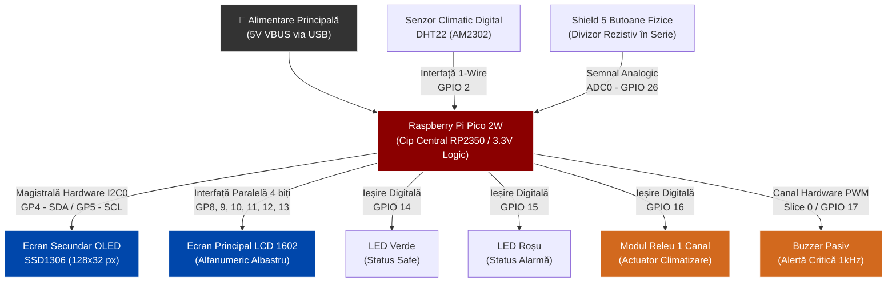
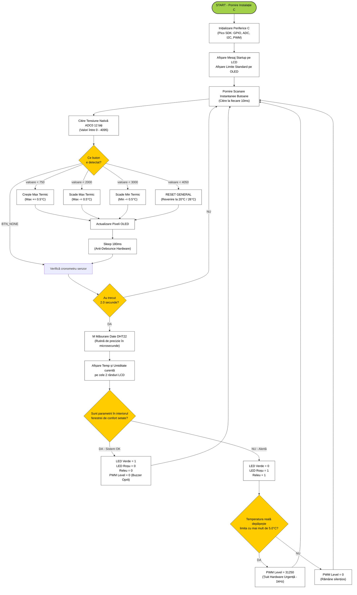

# Environmental Monitoring and Alert System | Embedded C · Raspberry Pi Pico 2 W

A microcontroller-based system for monitoring ambient temperature and humidity, displaying measurements and configurable thresholds, and controlling visual, audible, and relay-based alerts.

**Platform:** Raspberry Pi Pico 2 W (RP2350)  
**Language:** C (Raspberry Pi Pico SDK)

## Overview

The firmware reads environmental data from a **DHT22** sensor and displays the measurements on a **16×2 LCD**. Temperature and humidity thresholds are displayed on a separate **SSD1306 OLED** and can be adjusted using five buttons connected through a single ADC input. When a measurement leaves the configured range, the system controls LEDs and a relay; a passive buzzer provides an additional alert for large temperature deviations.

The application is implemented in C with the Pico SDK and interfaces directly with GPIO, ADC, I²C, and PWM peripherals.

## Technologies and Components

- **Firmware and build:** C11, Raspberry Pi Pico SDK, CMake
- **Microcontroller:** Raspberry Pi Pico 2 W (RP2350)
- **Sensors:** DHT22 temperature and humidity sensor (single-wire timing protocol)
- **Displays:** LCD 1602 (4-bit parallel interface), SSD1306 OLED (128×32, I²C)
- **User input:** Five-button resistor-ladder module read through the 12-bit ADC
- **Outputs:** Green/red LEDs, relay module, passive buzzer driven by hardware PWM

## Features

### Sensor acquisition and monitoring

- Reads temperature and relative humidity from the DHT22.
- Decodes the sensor's five-byte data frame and checks its checksum.
- Displays current measurements on the LCD.
- Compares measurements against configurable temperature and humidity thresholds.

### User interface

- Displays the configured temperature range and humidity limit on the OLED.
- Reads multiple buttons through one analog input by comparing ADC readings against voltage-dependent thresholds.
- Provides controls to increase/decrease temperature limits in 0.5 °C steps and restore default thresholds.

### Alerts and actuator control

- **Normal conditions:** Green LED on; red LED, relay, and buzzer off.
- **Outside configured limits:** Red LED and relay on.
- **Critical temperature deviation:** Buzzer enabled through a hardware PWM channel when temperature is at least 5 °C above the maximum or below the minimum threshold.
- The buzzer duty cycle is updated in firmware while PWM waveform generation is handled by the hardware peripheral.

---

## System Architecture

### Hardware Block Diagram

The RP2350 is the central controller: it receives measurements from the DHT22 and button input from the ADC, then drives both displays and the alert outputs.



### Functional Architecture

The application separates **sensor acquisition**, **user input**, **display updates**, and **threshold-based control**.

The firmware uses the Pico SDK for peripheral configuration and transactions, while the main loop coordinates the components sequentially.

---

## Hardware Connections

| Component | RP2350 GPIO | Interface |
| --- | --- | --- |
| DHT22 data | GP2 | Digital GPIO / timing-based protocol |
| SSD1306 SDA / SCL | GP4 / GP5 | I²C0 |
| LCD RS / E | GP8 / GP9 | Digital GPIO |
| LCD D4–D7 | GP10–GP13 | 4-bit parallel |
| Green / red LED | GP14 / GP15 | Digital output |
| Relay | GP16 | Digital output |
| Passive buzzer | GP17 | PWM |
| Five-button module | GP26 | ADC0 |

---

## Implementation Details

### Software Control-Flow Diagram

The diagram below summarizes the intended sequence implemented in `main()`.

Each iteration scans the button input, attempts a DHT22 reading, and updates the outputs according to the configured thresholds.

The application uses a **polling-based, blocking execution model**.




### Firmware Organization

The firmware is organized around three responsibilities:

1. **Hardware initialization:** Configure the I²C display, parallel LCD, DHT22 GPIO, ADC input, LEDs, relay, and PWM output.
2. **Data acquisition and user input:** Poll ADC readings for buttons, communicate with the DHT22, validate sensor data, and update the display.
3. **Control logic:** Evaluate environmental thresholds and set the LED, relay, and buzzer outputs.

The current implementation uses **blocking delays** for LCD timing, sensor communication, and button polling. PWM output generation is handled by the hardware peripheral.

---

## Hardware Test Scenarios

The following scenarios describe expected behavior to check on the assembled hardware.

| Scenario | Inputs / action | Expected observable behavior |
| --- | --- | --- |
| Normal operation | Temperature within the configured range and humidity below its limit | LCD displays measurements; green LED on; relay, red LED, and buzzer off |
| Threshold exceeded | Temperature or humidity outside the configured limits, without critical temperature deviation | Red LED and relay on; buzzer off |
| Critical temperature alert | Temperature at least 5 °C beyond a configured temperature limit | Red LED and relay on; PWM buzzer enabled |
| Restore defaults | Press SELECT | Temperature thresholds return to 20–26 °C and humidity limit to 60%; OLED is refreshed |
| Sensor read error | Invalid DHT22 frame or an error detected by the read function | LCD displays the sensor error message |

## Build and Run

**Requirements:** Raspberry Pi Pico SDK, a compatible ARM cross-compiler, CMake, and a Raspberry Pi Pico 2 W with the components wired as above.

1. Configure a working Pico SDK build environment. The repository's `CMakeLists.txt` sets `PICO_BOARD` to `pico2_w` and links the required peripheral libraries.
2. Configure and build the project:

   ```bash
   cmake -S . -B build
   cmake --build build
   ```

3. Put the board in BOOTSEL mode and copy the generated `StatieClima.uf2` firmware to the mounted device.
4. Connect the sensor, displays, buttons, LEDs, relay, and buzzer according to the wiring table.

## Project Structure

```text
statie-clima/
├── StatieClima.c          # Embedded application and peripheral handling
├── CMakeLists.txt         # Pico SDK build configuration
├── pico_sdk_import.cmake # Pico SDK integration
├── README.md              # Project overview and documentation
└── media/                 # Hardware photos and demonstration video
```

## Photos and Demonstration


[Watch the hardware demonstration](media/video.mp4)
